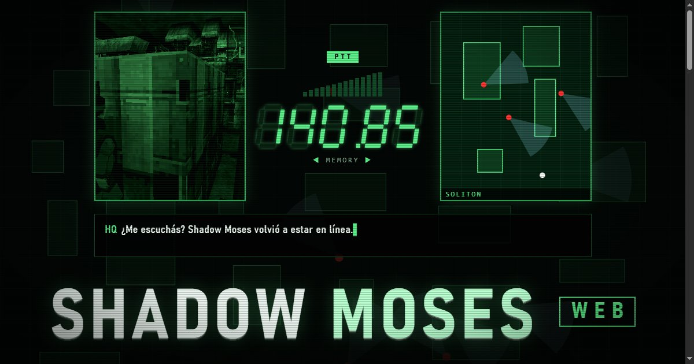
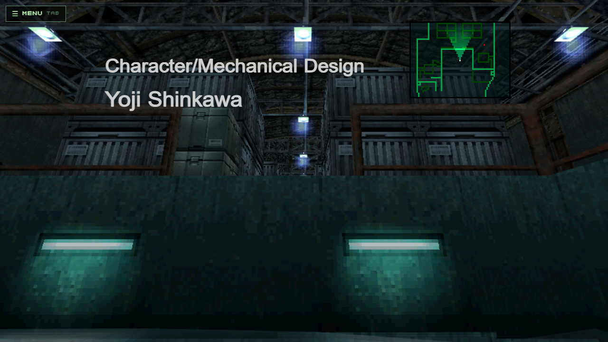
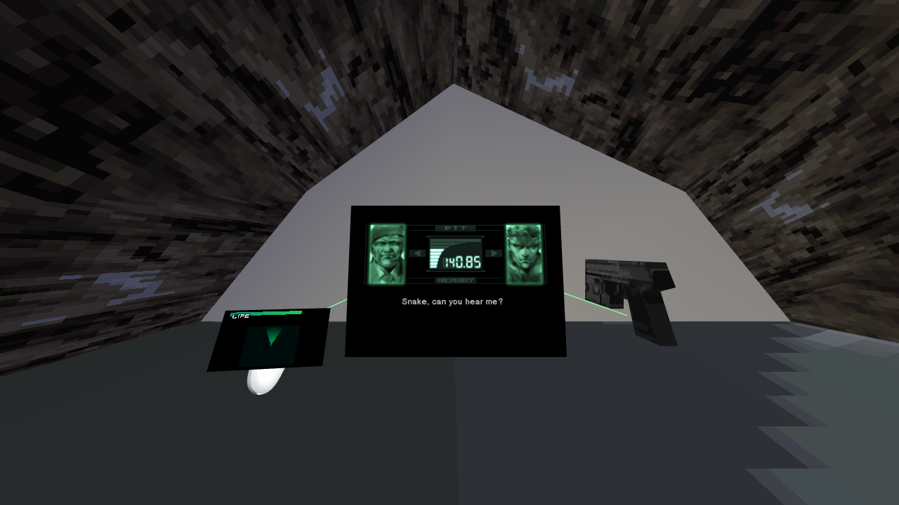

# Shadow Moses web

The 1998 PlayStation stealth classic, rebuilt for the browser: on PC, with a gamepad or with a VR headset.
You play it with **your own discs** (USA version): the installer converts them on your PC.

<b>◀ 140.85 ▶</b> · <a href="https://mgs.ravenlight.net/">mgs.ravenlight.net</a> · <a href="README.md">Versión en castellano</a>

> **Fan project, non-profit.** It includes no game files and downloads nothing: it only uses the disc files you choose.
> Metal Gear Solid is a trademark of Konami. This project is not affiliated with Konami.

<table>
<tr>
<td width="50%"> The dock, with the radar and the game credits</td>
<td width="50%"> The codec, in a VR headset</td>
</tr>
</table>

## `TX-01` OPERATION: INSTALL

1. **Download the Release** (`MGSweb_v1.1.zip`, in [Releases](../../releases/latest)) and unzip it anywhere.
2. **Double-click `INSTALAR.cmd`.**
3. **Choose your discs**: the `.cue` (or `.bin`) of disc 1 and disc 2. They are converted on your PC and the game opens
   in your browser (`http://127.0.0.1:8123`). It takes 5 to 8 minutes; if it stops, open `INSTALAR.cmd` again and
   it resumes.

Next times: the **Metal Gear Solid web** shortcut on the Desktop (or `JUGAR.cmd`). The black window is the server: keep
it open while playing. It only serves your PC.

## `TX-02` REQUIRED EQUIPMENT

- Windows 10 or 11, 64-bit, about 3 GB free. Nothing to install: Node, Python and FFmpeg are included.
- Your Metal Gear Solid PlayStation discs, **USA version** (SLUS-00594 and SLUS-00776), as `.bin/.cue`
  (or a 2352-byte-per-sector `.img`). A 2048-byte `.iso` won't work: it lacks the voices and videos.
- Without disc 2 you can play up to the disc change.
- Chrome or Edge. For VR: Meta Quest or Pico.

## `TX-03` VR HEADSET

- **From the PC:** Quest Link, Air Link or Virtual Desktop, with `http://127.0.0.1:8123` in Chrome or Edge.
- **With the headset browser over USB:** `CASCO_USB.cmd` (needs `adb` from Google's Android Platform Tools; it tells you how).

## `TX-04` CODEC: COMMON PROBLEMS

- **"Not the USA version"**: the USA version is required. Japanese, European and Integral are not supported yet.
- **"It is compressed"**: extract the `.7z`/`.zip` first and choose the `.cue`.
- **The conversion stopped**: open `INSTALAR.cmd` again; it resumes from the missing step.
- **Adding disc 2 later**: open `INSTALAR.cmd`, answer "N" (choose again) and pick both discs.

## `TX-05` CREDITS

FeniXVOID · Project Ravenlight.
Uses [three.js](https://threejs.org) (MIT), [Node.js](https://nodejs.org), [Python](https://python.org) with
[NumPy](https://numpy.org) and [Pillow](https://python-pillow.org), and [FFmpeg](https://ffmpeg.org) (GPL v3,
[source code](https://ffmpeg.org/download.html#get-sources)).
The converter's function and table names (`tools/names.txt`, `tools/tablas_ref.json`) come from the community work of
[FoxdieTeam/mgs_reversing](https://github.com/FoxdieTeam/mgs_reversing).
