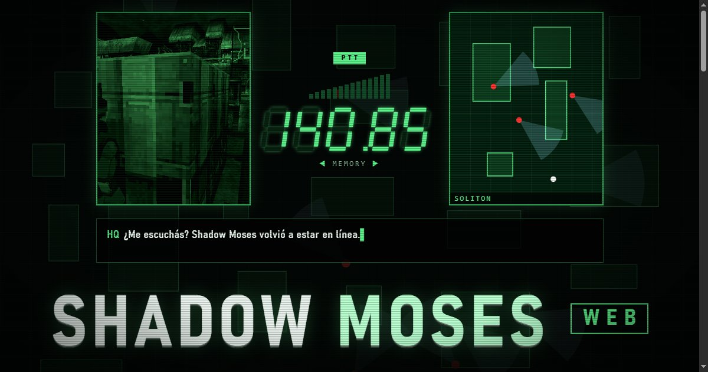
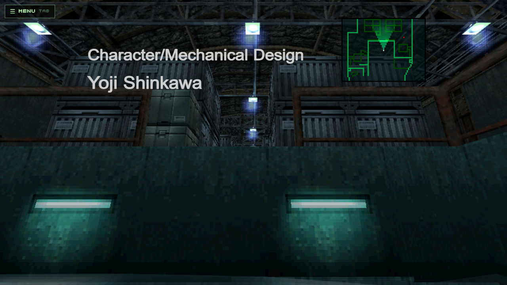
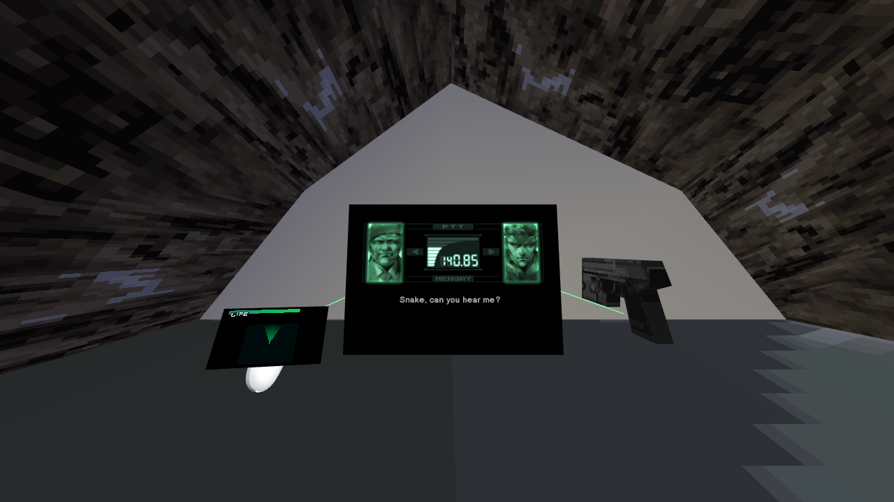

# Shadow Moses web

El clásico de sigilo de 1998 de PlayStation, rehecho para el navegador: en la PC, con joystick o con casco de realidad
virtual. También hay app para Android. Se juega con **tus propios discos** (versión USA): el instalador los convierte en tu PC.

<b>◀ 140.85 ▶</b> · <a href="https://mgs.ravenlight.net/">mgs.ravenlight.net</a> · <a href="README.en.md">English version</a>

> **Proyecto de fans, sin fines de lucro.** No trae ningún archivo del juego ni baja nada de internet: usa solo los
> archivos de los discos que elegís vos. Metal Gear Solid es una marca de Konami. Este proyecto no tiene relación con Konami.

<table>
<tr>
<td width="50%"> El muelle, con el radar y los créditos del juego</td>
<td width="50%"> El códec, en el casco de realidad virtual</td>
</tr>
</table>

## Novedades

- **v2.10:** las claymores ya no estaban dos veces y su daño sigue al original; la cámara, la máscara de gas, las antiparras y la mira del PSG1 usan sus dibujos del juego; el radar se traba con el chaff y aparece la barra de O2; Opciones suma BRILLO, CONTRASTE, COLOR y POLIGONOS; nuevo menú SPECIAL con el álbum de fotos, las fotos de fantasmas y PREVIOUS OPERATIONS, y la partida con smoking. Con el disco del Integral, además, muy fácil con la MP5 y la Meryl de la vuelta con smoking.
- **v2.9:** en primera persona, la caja de cartón se ve desde adentro, con el agujero del juego original, en la PC y en el casco. Se abre con su animación y el borde es difuso. Alrededor es cartón oscuro en lugar del negro del original.
- **v2.8:** en el casco, el cuerpo visible deja ver las piernas y los pies ya no atraviesan el piso. En los menús, el temblor de la mano ya no le saca la elección a la palanca y B vuelve al menú anterior. El menú muestra sólo lo que sirve donde estás, y el radar va en la mano sin arma, también para zurdos. El gesto contra Mantis ya no se activa con sólo girar la cabeza. La luz elegida queda guardada, y en OPCIONES el rayo y el mouse eligen la fila correcta.
- **v2.7:** en la PC, el juego abre en su propia ventana, sin barras ni ventana negra, y se apaga solo al cerrarla. Sigue andando sin internet.
- **v2.6:** ajustes finos en el menú del casco: margen de la Stinger, tiempo del gesto contra Mantis, ayuda de Campbell, fuerza del golpe, cuerpo visible y tamaño de la mira. En la PC también se pueden apagar el gesto y la ayuda.
- **v2.5:** llega la app para Quest: se juega sin PC y sin señal, con tus datos guardados en el casco. Todavía sin probar en un Quest de verdad.
- **v2.4:** la frecuencia de Meryl ya se puede encontrar: está en el dorso del estuche, en [la web](https://mgs.ravenlight.net/#estuche), y si seguís trabado Campbell te la dice. En el casco, la ventana de mira muestra las antiparras y el temblor del PSG1, y el modo con cuerpo sigue tu marcha.
- **v2.3:** un retruco nuevo contra Psycho Mantis, sin segundo mando: en el casco se cruzan los controles, en el celular se da vuelta el aparato y en la PC se cambia de mando. En el casco se arreglan también el modo sentado y los binoculares.
- **v2.2:** llega el paquete para Linux y Mac, todavía sin probar en un Linux ni en una Mac de verdad. Instalar con un disco y sumar el segundo después ya no recorta el catálogo de modelos. En el casco, los golpes, la marcha y el radar siguen a tu cabeza aunque el mundo esté girado.
- **v2.1:** en el casco, la Stinger ya fija en primera persona: antes nunca lo hacía y al Hind no se le podía ganar así. La mira marca también al Hind y a REX. Con la cámara del juego y △, el misil sale hacia donde mirás.
- **v2.0:** ventana de mira en el casco: el PSG1 y los binoculares ahora tienen zoom, y la Nikita se ve desde adentro del misil.
- **v1.9:** en el casco ya se puede aguantar la tortura con los controles: antes los botones no respondían y se cortaba la historia. En el modo con cuerpo, las piernas corren con la animación de Snake.
- **v1.8:** opciones nuevas en el casco: manos de Snake, cuerpo visible y golpe con la mano. La palanca ahora gira la Nikita. Contra Psycho Mantis, sin segundo joystick: opción de puerto 2, o cambiar la mano hábil en plena pelea.
- **v1.7:** traje stealth con camuflaje a la vista, láser rojo que sale de la SOCOM, mira y recuadros en el Stinger y la Nikita. En el casco: visión nocturna y térmica, y los ítems ya no se ven dobles.
- **v1.6:** la app de celular ya exporta partidas y fotos: pregunta dónde guardarlas.
- **v1.5:** llega la app para Android: se juega sin navegador, sin PC y sin internet.
- **v1.3 y v1.4:** se puede jugar por wifi desde otro aparato de tu casa, por conexión segura y con música y efectos.
- **v1.2:** arreglo del instalador: con doble clic no se abría la ventana del disco 2.

## `TX-01` OPERACIÓN: INSTALAR

1. **Bajá el Release** (`MGSweb_v2.10.zip`, en [Releases](../../releases/latest)) y descomprimilo donde quieras.
2. **Doble clic en `INSTALAR.cmd`.**
3. **Elegí tus discos**: el `.cue` (o el `.bin`) del disco 1 y del disco 2. Los convierte en tu PC y se abre el juego
   en el navegador (`http://127.0.0.1:8123`). Tarda de 5 a 8 minutos; si se corta, abrí `INSTALAR.cmd` de nuevo y
   sigue desde donde quedó.

Las próximas veces: el acceso directo **Metal Gear Solid web** del Escritorio (o `JUGAR.cmd`). El juego abre en
su propia ventana y se apaga solo al cerrarla. Solo atiende a tu PC, y no necesita internet.

### Linux y Mac

Bajá el zip que termina en `_Linux_Mac.zip`, descomprimilo y corré `sh instalar.sh` en una terminal. Después, `sh jugar.sh`.
Usa lo que tengas instalado: Python 3.10 o más nuevo, Node.js 18 o más nuevo y FFmpeg con libx264. Si falta algo, el
instalador te dice qué comando correr. **Se probó simulando Linux en una PC con Windows, todavía no en un Linux ni en una
Mac de verdad:** si lo probás, contanos en un issue cómo te fue.

## `TX-02` EQUIPO NECESARIO

- Windows 10 u 11 de 64 bits, unos 3 GB libres. No hay que instalar nada: Node, Python y FFmpeg vienen adentro.
- Tus discos de Metal Gear Solid para PlayStation, **versión USA** (SLUS-00594 y SLUS-00776), en `.bin/.cue`
  (o `.img` de 2352 bytes por sector). Un `.iso` de 2048 bytes no sirve: le faltan las voces y los videos.
- Sin el disco 2 se juega hasta el cambio de disco.
- Chrome o Edge. Para VR: Meta Quest o Pico.

## `TX-03` CASCO DE REALIDAD VIRTUAL

- **Desde la PC:** Quest Link, Air Link o Virtual Desktop, con `http://127.0.0.1:8123` en Chrome o Edge.
- **Con el navegador del casco y cable USB:** `CASCO_USB.cmd` (necesita `adb`, de las Android Platform Tools de Google;
  ahí te dice cómo).

### Celular u otra PC, por wifi

Abrí `JUGAR_EN_RED.cmd` en la PC y entrá desde el otro aparato a la dirección que muestra. La PC tiene que quedar prendida
y en la misma red. La primera vez el navegador avisa que la conexión no es privada, porque el certificado lo crea tu propia
PC: tocá "Avanzado" y "Continuar". Mientras esa ventana esté abierta, **cualquiera en esa red puede entrar**: usalo en tu
casa, no en un wifi público. También sirve desde el navegador del casco, aunque todavía no se probó en uno real.

### App de celular (Android)

1. Instalá el juego en la PC y hacé doble clic en `ARMAR_ARCHIVO_CELULAR.cmd`: arma `MGSweb_datos.mgs`, cerca de 1 GB.
2. Bajá `ShadowMoses_celular.apk` de [Releases](../../releases/latest) e instalala. Android te va a pedir permiso para
   instalar apps de fuera de la tienda.
3. Copiá `MGSweb_datos.mgs` al celular, abrí la app y elegilo. Después no hace falta la PC ni internet: la app no tiene
   permiso de internet.

La app no trae ningún archivo del juego. El archivo `.mgs` son tus datos: no lo subas ni lo compartas. Para exportar una
partida o una foto, la app pregunta dónde guardarla. No trae realidad virtual. Se probó en un celular virtual con Android 14,
todavía no en uno real: si la probás, contanos en un issue qué celular usaste y cómo te fue.

## `TX-04` CÓDEC: PROBLEMAS COMUNES

- **"No es la versión USA"**: hace falta la USA. La japonesa, la europea y la Integral todavía no.
- **"Está comprimido"**: descomprimí el `.7z`/`.zip` primero y elegí el `.cue`.
- **La conversión se cortó**: abrí `INSTALAR.cmd` de nuevo; retoma desde el paso que faltaba.
- **Después quiero sumar el disco 2**: abrí `INSTALAR.cmd`, elegí "N" (elegir de nuevo) y los dos discos.

## `TX-05` CRÉDITOS

FeniXVOID · Project Ravenlight.
Usa [three.js](https://threejs.org) (MIT), [Node.js](https://nodejs.org), [Python](https://python.org) con
[NumPy](https://numpy.org) y [Pillow](https://python-pillow.org), y [FFmpeg](https://ffmpeg.org) (GPL v3,
[código fuente](https://ffmpeg.org/download.html#get-sources)).
Los nombres de funciones y tablas del conversor (`tools/names.txt`, `tools/tablas_ref.json`) salen del trabajo de la
comunidad [FoxdieTeam/mgs_reversing](https://github.com/FoxdieTeam/mgs_reversing).
